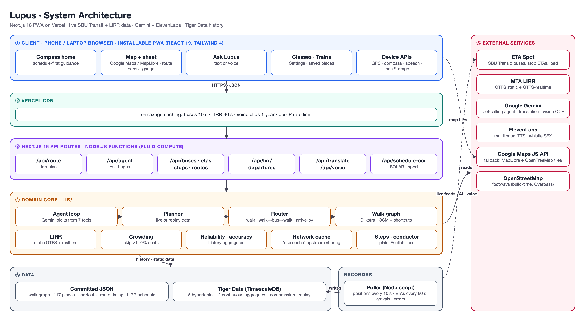
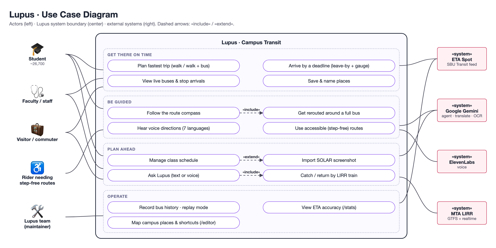
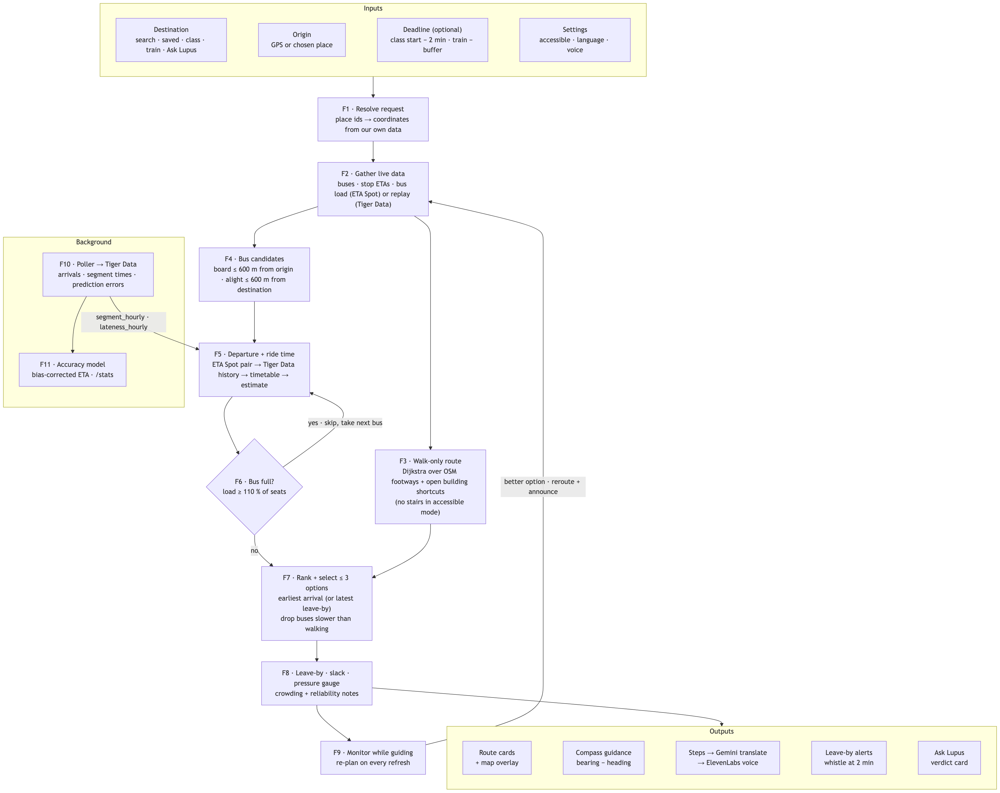

# Lupus · Campus Transit for Stony Brook University

> A mobile-first web app (PWA) that tells a Stony Brook student, employee or visitor **when to leave, which way to walk,
> and which campus bus to catch** to get anywhere on campus on time, using live bus data, LIRR trains, their
> class schedule, voice guidance in seven languages, and an AI trip assistant. Built for **SBUHacks 2026**.

---

## 1. Problem

Getting around Stony Brook's 1,000+ acre campus is harder than it should be:

- **The official tracker only shows dots on a map.** ETA Spot shows where buses are and per-stop predictions, but it
  doesn't answer the real question: *"I'm at West Apartments and my lab in Life Sciences starts at 2:00. When do I
  leave, and should I walk or take the bus?"* Riders have to combine the bus map, a walking app and their own guesswork.
- **Its predictions drift.** Bus ETAs can be minutes off, and riders don't know which predictions to trust.
- **Walking is often faster than waiting,** but nobody tells you that. Google/Apple Maps don't know campus footpaths,
  building cut-throughs or SBU Transit's loops.
- **Buses fill up.** At class change a packed Outer Loop bus can leave you standing at the stop.
- **Train connections are a separate app.** Catching the LIRR at Stony Brook station means checking MTA, then the bus
  tracker, then working out the walk.
- **Not everyone is served equally.** Riders who need step-free routes, or whose first language isn't English, get
  no help from existing tools.

## 2. Who benefits

| Group | Approx. size | How Lupus helps |
| --- | --- | --- |
| Undergraduate students | ~18,300 | Class-driven "leave by" times, walk vs. bus, packed-bus rerouting |
| Graduate & professional students | ~8,400 | Trips between West Campus, the Hospital/HSC and housing |
| **All students (Fall 2024)** | **~26,700** | Source: SBU Office of Institutional Research fact book |
| Residents (on-campus beds) | ~10,000+ | Dorm ↔ academic trips, late shuttles |
| Commuters | ~16,000 | LIRR ↔ campus connections, parking-lot ↔ building trips |
| Faculty & staff (incl. Stony Brook Medicine) | ~15,000+ (approx.) | Hospital/Chapin line, Hospital ↔ main campus |
| Visitors, patients, prospective students | thousands per week | No install, works in any phone browser |

**Addressable community: roughly 40,000 people** who move around the campus daily, every one of whom can open Lupus in
a browser with no account and no install.

> Figures are approximate. Student counts are from SBU's Fall 2024 fact book (26,689 total, 18,263 undergraduate);
> housing capacity from published reports of ~10,300 beds; employee count is the commonly cited figure and should be
> verified with SBU HR before quoting publicly.

## 3. Solution overview

Lupus is a single Next.js app that:

1. Pulls **live bus positions, per-stop ETAs and bus occupancy** from SBU's ETA Spot feed.
2. Plans the **fastest walk-only or walk → wait → bus → walk** trip over a campus walking graph built from
   OpenStreetMap plus hand-mapped building shortcuts.
3. Works backwards from a **deadline** (a class, a train) to give a **leave-by time** and a **pressure gauge**
   (stroll / walk briskly / run).
4. Guides you with a **route-following compass** and **spoken directions** (ElevenLabs voice, Gemini translation).
5. Answers natural-language questions through **Ask Lupus**, a Gemini tool-calling agent whose every fact comes from
   our own router and feeds.
6. Records the bus feed into **Tiger Data (TimescaleDB)** to measure and correct ETA Spot's prediction error, and to
   replay real buses for demos.

The theme is **"Steel & Steam"**: a friendly train conductor voice, a steam whistle when your bus is two minutes out,
and brass/glass UI.

## 4. Features (all implemented)

### 4.1 Schedule-first compass home (phones)
- Home screen on phones is the **compass**, not a map. It reads your **class schedule**, picks the **next class**,
  and plans a trip that arrives 2 minutes before it starts.
- Shows **"Next up: CSE 214 · Javits Lecture Center · starts 10:00"**, a **countdown to leave-by**, a one-line leg
  summary (`Walk 4 min › Outer Loop › Walk 2 min`) and the **pressure gauge**.
- **Guide me** turns the phone into a **route-following compass**: the needle points along the route (to the next
  turn, the bus stop, then the destination), with phases *walk to stop → wait → ride → walk → arrive*.
- **Live rerouting:** if a better option appears mid-trip (e.g. your bus filled up), the plan switches and Lupus says
  so: *"Outer Loop bus 61 is full, so Lupus picked the next best way. New plan: …"*
- Saved places appear as quick-start chips; **Map** is always one tap away.
- Laptops/desktops (no GPS or compass) always get the map view.

### 4.2 Live map and trip planner
- **Google Maps JavaScript API** base map, with automatic fallback to **MapLibre + OpenFreeMap** if Google fails
  (no key, billing, quota).
- Live bus markers (refreshing every ~10 s), route lines and stops for **Outer Loop, Hospital/Chapin,
  Port Jefferson Shuttle** and charters.
- **Transit-map lanes:** where routes share a road, they are drawn side by side like lanes, with smooth lane-change
  ramps, on both map engines.
- **Where to?** search over **117 campus places** (buildings, dorms, dining, hospital, parking, LIRR station,
  off-campus shopping and Port Jefferson) with nicknames ("SAC", "Life Sci", "Javits").
- **Up to three route cards** with leave-by, arrival time, walk/wait/ride breakdown, live vs. estimated departures,
  crowding ("Plenty of seats", "Standing room only", "Full"), and reliability notes from history.
- **Best / Bus / Walk filter.** A bus that loses to walking is never offered as "best"; Lupus tells you to walk.
- **Arrive-by planning:** returns the latest departure that still makes it, with slack minutes.
- **Change start point**: my location or any place; location-blocked help with device-specific fixes.
- **Follow me / heading-up navigation** map mode, paused when you drag the map.
- **Tap a stop** to see the next arrivals at that stop.

### 4.3 Turn-by-turn navigation with the conductor voice
- Step list in plain English (*"Walk 4 min to the SAC stop."*, *"Board the Outer Loop at SAC, 10:42 AM."*,
  *"Ride 3 stops and get off at …"*, *"Cut through …"* for open building shortcuts).
- Spoken by an **ElevenLabs multilingual voice** (clips CDN-cached), falling back to browser speech.
- **Steam whistle + announcement** when the bus is ~2 minutes from your stop.
- **Leave-by alerts**: *"Leave in 5 minutes…"* and *"Time to leave…"* spoken once each.
- Directions **translated with Gemini** into **English, Español, 中文, हिन्दी, 한국어, العربية, Français**.

### 4.4 Ask Lupus (AI trip assistant)
- Type or **speak** a question: *"I'm at West Apartments, lab in Life Sciences at 2. Will I make it?"*,
  *"Get me to the next train to the city"*, *"Fastest way from SAC to Chapin?"*
- A **Gemini function-calling agent** chooses among 7 tools: `find_place`, `plan_trip`, `lirr_departures`,
  `catch_train`, `bus_status`, `stop_departures`, `show_answer`.
- Returns a **verdict** (*You'll make it / Tight: walk fast / You'll be late*), buffer minutes, and an answer card
  with **Guide me** (compass) or **Show on map**.
- **Gemini never invents times or coordinates**: it picks place ids and tools; every time, stop and route on the
  card is computed by our router. An offline **mock agent** keeps the feature working without a key.

### 4.5 Classes
- Add classes manually (course, days, start time, building).
- **Import a SOLAR schedule screenshot**: Gemini vision extracts classes, which are validated and shown for review.
- **Next class** countdown with one-tap "Go"; stored only on the device (localStorage).

### 4.6 LIRR connections
- **Catch a train:** next westbound (to Jamaica / NYC) or eastbound (Port Jefferson) trains from Stony Brook station,
  merging the MTA static GTFS schedule with **GTFS-realtime delays and cancellations**.
- Pick a train and Lupus plans the trip to the platform with your **train buffer** (2–10 min, configurable).
- **Coming back by train:** choose an arriving train and a destination (searchable, savable) and plan the trip
  from the station.
- Labeled "schedule only" fallback when the realtime feed is down.

### 4.7 Crowding-aware routing
- Uses ETA Spot's load ÷ capacity. A bus counts as unboardable at **110% of seats** (standing room).
- Packed buses are skipped; the next best option is chosen, shown and spoken.
- Demo toggle **"Pretend the next bus is full"** shows the reroute live.

### 4.8 Accessibility
- **Accessible routes**: avoid stairs and shortcuts with steps, assume a slower walking pace.
- Large touch targets (≥44 px), screen-reader labels, `aria-live` ETA and status updates, voice output.

### 4.9 Saved places
- Star any place from search results, the route header or the trains panel; **rename freely** ("Home", "Lab").
- Saved places become chips on the home screen, compass and search.

### 4.10 Tiger Data: history, accuracy and replay
- A **poller** records bus positions (10 s), every stop's ETA prediction (60 s), detected arrivals, stop-to-stop
  segment times and ETA Spot's prediction error at 2–5, 5–10 and 10–20 min horizons.
- **Continuous aggregates** (`segment_hourly`, `lateness_hourly`) feed the router when ETA Spot can't pair a trip and
  produce reliability notes ("Usually 2 min later than shown").
- **`/stats` accuracy study:** 70/30 time-split train/test; Lupus' bias-corrected ETA vs. ETA Spot's on identical
  held-out arrivals (mean error, median, % within 1 minute, by horizon).
- **Replay mode** (`/?replay=1`) plays recorded buses and their ETAs as if live.
- Compression after 6 hours keeps everything on the free tier.

### 4.11 Campus editor (`/editor`, local only)
- Satellite-view tool to add/move/rename **places**, draw missing **footpaths** (with "has stairs"), and map
  **building shortcuts** with entrance → exit points, weekday/weekend hours and step-free flags.
- Saves to `data/*.json`; refused on deployed builds.

### 4.12 Platform
- **Installable PWA** (manifest, icons, standalone display), Apple-style glass UI, light and dark.
- **Graceful degradation everywhere:** no keys → MapLibre map, browser voice, English, mock agent, schedule fallback.
- API responses cached at the CDN (`s-maxage` 10 s buses, 30 s LIRR, 1 year voice clips) with a per-IP rate limit.

## 5. Technology stack

| Layer | Technology |
| --- | --- |
| Framework | **Next.js 16** (App Router, Cache Components / `use cache`, Turbopack), **React 19**, TypeScript |
| Styling | Tailwind CSS 4, custom glass/brass theme |
| Maps | Google Maps JavaScript API (`@googlemaps/js-api-loader`), MapLibre GL 6 + OpenFreeMap fallback |
| AI | Google **Gemini** (`@google/genai`): function-calling agent, translation, vision OCR |
| Voice | **ElevenLabs** multilingual TTS and sound effects (whistle), Web Speech API fallback and speech input |
| Transit data | **ETA Spot** (SBU Transit) JSON API; **MTA LIRR** GTFS static + GTFS-realtime (`gtfs-realtime-bindings`) |
| Walking data | **OpenStreetMap** (Overpass) footways + hand-mapped paths and shortcuts |
| Time-series DB | **Tiger Data (TimescaleDB)** via `postgres`: hypertables, continuous aggregates, compression |
| Hosting | **Vercel** (Node.js functions on Fluid Compute, CDN caching) |
| Testing | Vitest unit tests on real recorded samples (`data/samples/`) |

## 6. Architecture

```
 Phone / laptop browser (PWA)
   React client: Compass home · Map + bottom sheet · Ask Lupus · Classes · Trains · Settings
   Device APIs: GPS, compass heading, speech in/out, localStorage (settings, classes, saved places)
        │  HTTPS (JSON, cached at Vercel CDN)
        ▼
 Next.js 16 on Vercel — API routes
   /api/route  /api/agent  /api/buses  /api/etas  /api/stops  /api/routes
   /api/lirr/departures  /api/translate  /api/voice  /api/schedule-ocr  /api/editor (dev only)
        │
   Domain core (lib/): planner → router (walk / walk+bus+walk) → walk graph (Dijkstra)
                       lirr (static + realtime) · agent (tool loop) · crowding · segments · accuracy
        │
   Upstreams: ETA Spot · MTA GTFS-RT · Gemini · ElevenLabs · Google Maps / OpenFreeMap tiles
   Storage:   Tiger Data (history, aggregates, replay) · committed data/*.json (walk graph, places,
              shortcuts, route timing, LIRR schedule)
        ▲
 Poller (Node script on a laptop/VM) ── ETA Spot ──► Tiger Data
```

### Diagrams

| Architecture | Use case | Functional |
| --- | --- | --- |
|  |  |  |

Sources: `docs/diagrams/src/*.html` (architecture, use case) and `docs/diagrams/functional.mmd` (Mermaid).
Demo script: [`docs/Demo_Script.md`](docs/Demo_Script.md). Demo videos: [`docs/demo/`](docs/demo/).

## 7. How the core works

**Routing (`lib/router.ts`).** For each request, compute a direct walk; then for every route, every boarding stop
within 600 m walking of the origin and every alighting stop within 600 m of the destination, find the first catchable
departure (be at the stop 1 minute early), its ride time and the final walk. Ride times come from, in order:
ETA Spot (same trip seen at both stops) → Tiger Data historical segment averages for that hour → the scheduled
timetable → a distance-based estimate. Departures beyond ETA Spot's list are projected by headway only while buses
are actually running. Options are ranked by earliest arrival (or latest leave-by for arrive-by trips); packed buses
are skipped; up to three options are returned with `leaveBy`, `arriveAt`, `slackMinutes` and a breakdown.

**Walking (`lib/walk.ts`).** Dijkstra over the OSM footway graph plus hand-entered paths and building shortcuts.
Shortcuts are skipped when the building is closed (campus clock, America/New_York) or, in accessible mode, when they
have stairs. Off-map destinations fall back to a straight-line walk with a detour factor.

**Compass (`lib/compass.ts`).** Projects the user onto the route, picks the next waypoint, computes the bearing and the
trip phase; the needle is that bearing minus the device heading.

**Agent (`lib/agent/`).** A bounded loop: Gemini picks tools, the server runs them against live data, and the turn
ends with `show_answer`, which points at a stored plan by id. The card is built from that plan, never from model text.

**LIRR (`lib/lirr.ts`).** MTA GTFS reduced at build time to Stony Brook trips (`data/lirr-stony-brook.json`), merged at
request time with GTFS-realtime delays/cancellations.

**Accuracy (`lib/accuracy.ts`).** Lupus ETA = ETA Spot ETA + mean training error for the same route, hour and horizon
(falling back to coarser groups). Scored against ETA Spot on held-out arrivals.

## 8. Data model (Tiger Data)

| Table | Written | Contents |
| --- | --- | --- |
| `vehicle_snapshots` | every 10 s | bus id, route, lat/lng, heading, next stop, load |
| `eta_predictions` | every 60 s | ETA Spot's prediction per stop and trip |
| `stop_arrivals` | on arrival | bus within 30 m of a stop on its route |
| `segment_times` | on arrival | seconds since the bus's previous stop |
| `prediction_errors` | on arrival | ETA Spot error at 2/5/10-min horizons |
| `segment_hourly`, `lateness_hourly` | continuous aggregates | hourly averages used by the router and badges |

Client-side (localStorage): settings (language, voice, accessible, train buffer), classes, saved places, mode.

## 9. API reference

| Endpoint | Purpose |
| --- | --- |
| `GET /api/route?from&to&time&arriveBy&accessible&replay&demoFull` | Plan a trip (≤3 options) |
| `POST /api/agent` | Ask Lupus question → verdict, message, answer card, tool steps |
| `GET /api/buses[?replay=1]` | Live (or replayed) bus positions |
| `GET /api/routes`, `GET /api/stops`, `GET /api/etas?stop=` | Network and per-stop ETAs |
| `GET /api/lirr/departures?kind&direction&limit` | LIRR departures/arrivals at Stony Brook |
| `POST /api/translate` | Gemini translation of step lines |
| `GET /api/voice` | ElevenLabs clip for a line (CDN-cached) |
| `POST /api/schedule-ocr` | SOLAR screenshot → classes |
| `POST /api/editor` | Save hand-mapped data (dev only) |

## 10. Reliability and fallbacks

| Missing / failing | Lupus does |
| --- | --- |
| ETA Spot down | Walking directions + timetable; "Bus feed down" badge |
| No live trip pairing | Tiger Data history → schedule → distance estimate, marked "estimated" |
| LIRR realtime down | Static schedule, labeled "schedule only" |
| Gemini key/quota | Mock agent, English directions, manual class entry |
| ElevenLabs | Browser speech synthesis |
| Google Maps | MapLibre + OpenFreeMap |
| Location blocked | Device-specific help + pick a start place |
| No buses running (demo) | Replay mode from Tiger Data |

## 11. Quality

- Unit tests (Vitest) for router, walking, compass, lanes and lane joins, crowding, LIRR, arrivals, segments,
  accuracy, classes, ETA Spot parsing and the agent, all against real recorded samples.
- `npm run typecheck`, `npm run lint`.

## 12. Running it

```bash
npm install
cp .env.example .env.local   # optional keys: ELEVENLABS_*, GEMINI_API_KEY, DATABASE_URL, NEXT_PUBLIC_GOOGLE_MAPS_*
npm run dev                  # http://localhost:3000   (/?replay=1 for recorded buses, /stats, /editor)
npm run poller               # record bus data into Tiger Data
```

## 13. Future work

- Push notifications for leave-by alerts with the app closed.
- Multi-bus transfers and Suffolk County Transit connections.
- Official integration with SBU Transit and SOLAR (no screenshot step).
- Crowd-sourced "bus just left full" reports to sharpen crowding.

## 14. Credits

Base map by Google Maps (fallback: OpenFreeMap). Walking network and building data © OpenStreetMap contributors
(ODbL). Transit data from ETA Spot (Stony Brook University) and MTA. Built with Next.js, MapLibre, ElevenLabs,
Gemini and Tiger Data. Ask Lupus agent and route lanes adapted from Tanmay's work.
