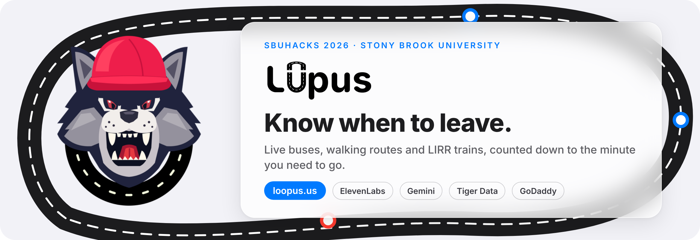
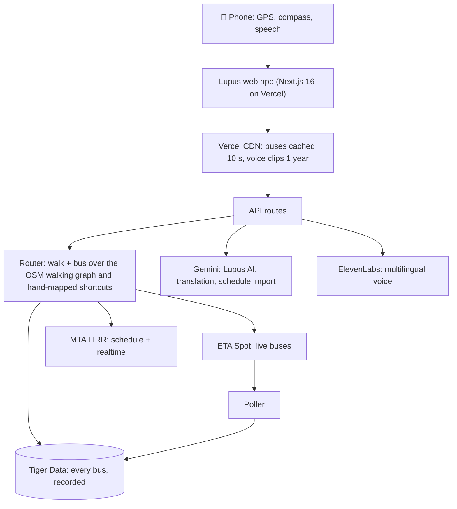

<div align="center">

<a href="https://loopus.us"></a>

<h3>Campus transit for Stony Brook University, counted down to the minute you need to go.</h3>

<p>
  <a href="https://loopus.us"></a>
  
  
</p>

<p>
  
  
  
  
</p>

<p>
  <a href="https://loopus.us"><b>Open the app</b></a> ·
  <a href="#-tracks">Tracks</a> ·
  <a href="#-features">Features</a> ·
  <a href="#-how-it-works">How it works</a> ·
  <a href="#-run-it-locally">Run it locally</a>
</p>

</div>

---

## 🐺 Why Lupus

Stony Brook's official bus tracker shows dots on a map. To find out when to leave, you tap stop after
stop, guess which bus goes where, and hope the ETA holds. **Lupus starts from where you need to be.** Add
your class schedule once, and it picks your next class, finds the fastest walk or walk + bus + walk
route, and tells you exactly when to leave, in your language, out loud.

**The name:** *lupus* is Latin for wolf, for the Stony Brook Seawolves. **The domain:** our buses run in
loops around campus, so the app lives at **[loopus.us](https://loopus.us)**.

## 🏆 Tracks

### Core tracks

| Track | Why Lupus fits |
| --- | --- |
| 🥇 **Best Overall** | **A real problem every Stony Brook student has, solved end to end and live today at [loopus.us](https://loopus.us).** Instead of tapping stops on a dot map and guessing, you get one answer: when to leave. Behind it: a walk + bus router over live ETA Spot buses, MTA LIRR realtime and a walking graph from OpenStreetMap plus hand-mapped building shortcuts; four sponsor technologies each doing real work (voice, AI, data history, domain); a recorded bus history that measures ETA Spot's error; and a fallback for every service so the demo never breaks. 80 automated tests run against real saved bus data. |
| 🎨 **Best UI/UX** | **Designed around a decision, not a map.** The home screen starts from your schedule and a compass that points the way, with the map one tap away. A gauge says stroll, walk or run; a whistle and a spoken alert tell you when to go. Apple-style glass panels keep the map visible, directions are spoken in 7 languages, accessible routes avoid stairs, starred places become one-tap trips, and Ask Lupus answers plain questions ("lab in Life Sciences at 2, will I make it?") by typing or voice. |

### MLH tracks

| Track | What we built with it | Where it lives |
| --- | --- | --- |
|  **ElevenLabs** | **Multilingual voice for accessibility.** Every walking step and leave-by alert is spoken aloud by a "conductor" voice using the `eleven_multilingual_v2` model, in 7 languages (English, Español, 中文, हिन्दी, 한국어, العربية, Français). Riders can follow directions without reading the screen. Clips are cached at the edge for a year. | `app/api/voice`, `lib/voice.ts` |
|  **Google Gemini** | **Lupus AI:** an agent that answers "I'm at West Apartments, lab in Life Sciences at 2. Will I make it?" by calling our own routing tools. **Multilingual accessibility:** translates every direction into the rider's language before it's spoken. **Class schedule importer:** reads a screenshot of your SOLAR schedule and turns it into classes Lupus plans around. Gemini only picks from ids we give it; times and coordinates always come from our data. | `lib/agent/`, `lib/translate.ts`, `lib/scheduleOcr.ts` |
|  **Tiger Data** | **Every bus, recorded in the cloud.** A poller stores bus positions every 10 s, ETA Spot's predictions for every stop every 60 s, and each real arrival in TimescaleDB hypertables with continuous aggregates. That history is how Lupus computes **more accurate ETAs**: recorded ride times fill in when live data can't pair a trip, lateness by route and hour becomes notes like "Usually 2 min later than shown" on route cards, and the `/stats` study scores a bias-corrected model against ETA Spot on held-out arrivals. It also powers **replay mode** for demos. | `scripts/poller.ts`, `lib/history.ts`, `lib/planner.ts`, `lib/accuracy.ts`, `app/stats` |
|  **GoDaddy** | **[loopus.us](https://loopus.us)**, registered with GoDaddy. *Lupus* for the Seawolves, *loopus* for the buses that loop around campus. | DNS → Vercel |

## ✨ Features

<table>
<tr>
<td width="50%" valign="top">

**🧭 Schedule-first compass**<br>
Add your classes once. Lupus picks the next one, routes you there and points the way with a live
compass, with the map one tap away.

**⏱️ Know when to leave**<br>
A gauge shows whether to stroll, walk or run, and a whistle plus a spoken alert fire 5 minutes
before you need to go, then again when it's time.

**🚌 Live buses, smarter routes**<br>
Live ETA Spot data, walk → bus → walk routing, and crowding-aware choices: if your bus is full,
Lupus picks the next best way.

**🚆 LIRR connections**<br>
Stony Brook trains from MTA's schedule merged with realtime delays and cancellations, with a buffer
to buy a ticket and reach the platform.

</td>
<td width="50%" valign="top">

**🗣️ Directions in your language**<br>
Steps translated with Gemini and spoken with ElevenLabs in 7 languages.

**♿ Accessible routes**<br>
One switch avoids stairs and assumes a slower pace. Hand-mapped building shortcuts are used only
while the building is open, and only step-free ones in accessible mode.

**🤖 Ask Lupus**<br>
Type or say your question; the Gemini agent plans with live data and shows the trip on the map.

**📈 Honest ETAs**<br>
`/stats` compares ETA Spot's prediction error with ours on held-out arrivals recorded in Tiger Data.

</td>
</tr>
</table>

## 🛠 How it works



- **Routing** (`lib/router.ts`): walk only, or walk → wait → one bus → walk. Ride times come from ETA Spot,
  then Tiger Data history, then the scheduled timetable. Every option has a leave-by time and slack,
  which drive the gauge.
- **Walking** (`lib/walk.ts`): shortest paths over OpenStreetMap footways plus hand-mapped building
  shortcuts with opening hours, skipped when closed or, in accessible mode, when they have stairs.
- **Every service has a fallback**: no Google Maps key → MapLibre; no ElevenLabs → browser speech; no
  Gemini → place search and English; no live buses → Tiger Data history, then the timetable.

<details>
<summary><b>Built with</b></summary>

| Layer | Tools |
| --- | --- |
| App | Next.js 16 (App Router), React 19, Tailwind CSS 4, PWA |
| Maps | Google Maps JavaScript API, MapLibre GL + OpenFreeMap fallback, OpenStreetMap |
| Data | ETA Spot (Stony Brook buses), MTA LIRR GTFS and GTFS-realtime |
| AI and voice | Google Gemini, ElevenLabs |
| Storage | Tiger Data (TimescaleDB) |
| Hosting | Vercel, GoDaddy domain |
| Tests | Vitest (15 suites, 80 tests) |

</details>

## 🚀 Run it locally

```bash
npm install            # also copies the MapLibre worker into public/
cp .env.example .env.local
npm run dev            # http://localhost:3000
npm test               # unit tests against real saved bus data
```

Everything core (map, live buses, routing, LIRR) works with no keys at all. Keys switch on the extras.

<details>
<summary><b>Environment variables</b></summary>

| Name | Enables | Without it |
| --- | --- | --- |
| `ELEVENLABS_API_KEY`, `ELEVENLABS_VOICE_ID` | Conductor voice (ElevenLabs multilingual TTS), whistle generation | Browser speech |
| `ELEVENLABS_MODEL` (optional) | TTS model, default `eleven_multilingual_v2` | |
| `GEMINI_API_KEY` | Ask Lupus, translated directions, SOLAR screenshot import | Place search, English, manual class entry |
| `GEMINI_MODEL` (optional) | Default `gemini-flash-latest` | |
| `DATABASE_URL` | Tiger Data: history fallback, reliability notes, `/stats`, replay mode | Schedule fallback, no notes |
| `NEXT_PUBLIC_GOOGLE_MAPS_API_KEY` | Google Maps base map (Maps JavaScript API) | MapLibre + OpenFreeMap |
| `NEXT_PUBLIC_GOOGLE_MAP_ID` (optional) | Your Cloud map style; default `DEMO_MAP_ID` | |

Keys live in `.env.local` locally and in Vercel project settings in production. Never commit them.
The Google Maps key runs in the browser, so restrict it to your domains and to the Maps JavaScript API.

</details>

<details>
<summary><b>Scripts</b></summary>

| Script | What it does |
| --- | --- |
| `npm run dev` / `build` / `start` | Next.js |
| `npm test` | Unit tests (Vitest), using real saved samples in `data/samples/` |
| `npm run typecheck` / `lint` | Type and lint checks |
| `npm run poller` | Record live bus data into Tiger Data |
| `npm run accuracy` | Print the ETA accuracy study (same as `/stats`) |
| `npm run build:walk` | Rebuild `data/walk-graph.json` from OpenStreetMap (Overpass) |
| `npm run build:lirr` | Rebuild `data/lirr-stony-brook.json` from MTA's LIRR GTFS |
| `npm run build:timing` | Rebuild `data/route-timing.json` from ETA Spot's per-stop schedule (best run early morning) |
| `npm run make:whistle` | Generate `public/sounds/whistle.mp3` with ElevenLabs sound effects |

Add `--refresh` to `build:walk` / `build:lirr` to re-download instead of using `data/cache/`.
Re-run `npm run build:lirr` when MTA publishes a new feed (see `validTo` in the JSON).

</details>

<details>
<summary><b>Recording bus data with Tiger Data</b></summary>

Vercel functions can't run long processes, so the recorder is a plain Node script you run on a laptop or
VM for the whole event. Start it first: replay mode, reliability notes and `/stats` need history.

1. Create a Tiger Data service and put its connection string in `.env.local`:
   `DATABASE_URL=postgres://tsdbadmin:…@….tsdb.cloud.timescale.com:5432/tsdb?sslmode=require`
2. Create the hypertables and continuous aggregates once: `npm run poller -- --init`
3. Leave it running (on macOS, `caffeinate -i npm run poller` keeps the laptop awake).

| Table | Written | Contents |
| --- | --- | --- |
| `vehicle_snapshots` | every 10 s | bus positions (deduplicated by GPS fix time) |
| `eta_predictions` | every 60 s | ETA Spot's prediction for every stop |
| `stop_arrivals` | on arrival | bus came within 30 m of a stop on its route |
| `segment_times` | on arrival | seconds since that bus's previous stop |
| `prediction_errors` | on arrival | ETA Spot's error 2–5, 5–10 and 10–20 min before arrival |

Continuous aggregates `segment_hourly` and `lateness_hourly` roll these up by route and hour. Every table
is compressed once its data is 6 hours old, and the per-stop sweep pauses while no buses are in service.
Try it without a database: `npm run poller -- --dry-run --once`.

</details>

<details>
<summary><b>Demo tools</b></summary>

- **Replay mode** plays recorded buses and their ETAs from Tiger Data on a loop as if live. Open
  `/?replay=1` (or `/?replay=0` to turn off), or tap the version line in Settings five times.
- **`/stats`** compares ETA Spot's prediction error with ours on held-out arrivals and explains the method.
- **`/editor`** (local only, needs the Google Maps key): map campus places, footpaths and building
  shortcuts by hand on satellite view. Saving writes `data/places.json`, `data/custom-paths.json` and
  `data/shortcuts.json`.

</details>

## 👥 Team

Built at **SBUHacks 2026** by Ishank Mishra, Mohdsidd and
[Tanmay Katke](https://github.com/tanmaykatke21).

## 🙏 Credits

Base map by Google Maps (fallback: OpenFreeMap tiles). Walking network and building data
© OpenStreetMap contributors (ODbL). Transit data from ETA Spot (Stony Brook University) and MTA.
Voice by ElevenLabs, AI by Google Gemini, history in Tiger Data, domain from GoDaddy.

<div align="center"><sub>🐺 Lupus · <a href="https://loopus.us">loopus.us</a> · know when to leave</sub></div>
